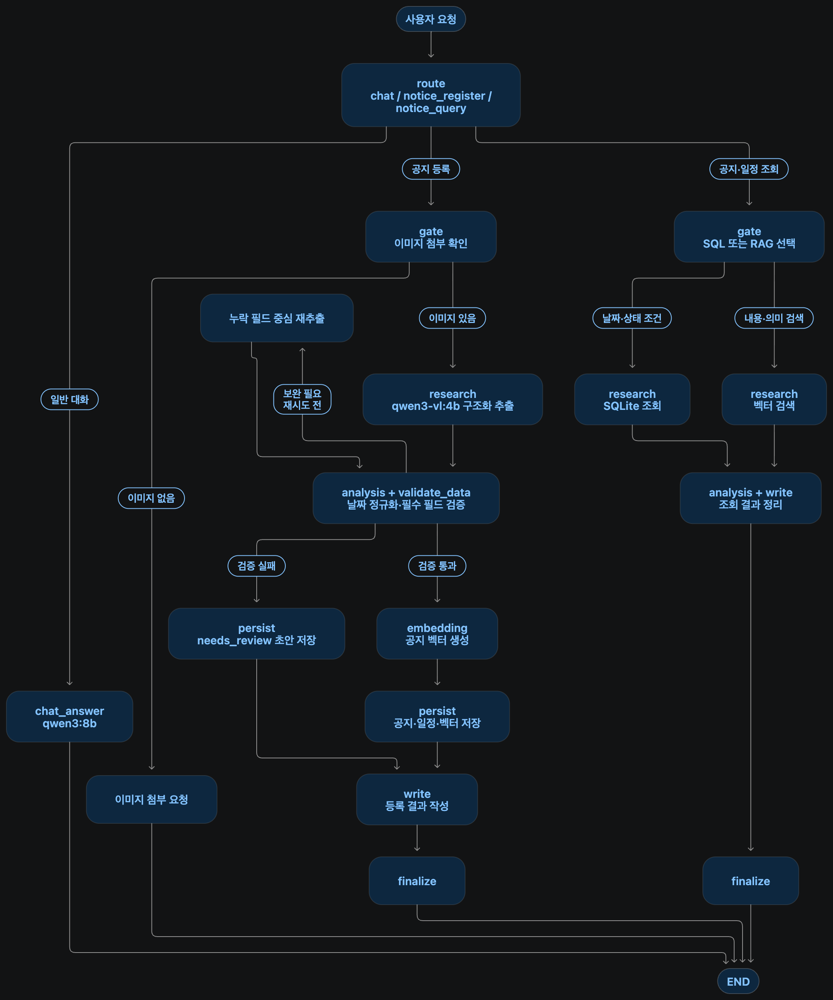

# Vision 기반 사내 공지·일정 관리 Agent 기획안

## 1. 주제 선정

### 1.1 주제명

**Vision 기반 사내 공지·일정 관리 Agent**

공지 사진에서 필요한 정보를 추출·저장하고, 자연어 질문으로 공지 내용과 일정을 확인하는 AI 서비스.

### 1.2 선정 배경

사진이나 캡처로 전달된 사내 공지는 사용자가 내용을 읽고 필요한 일정을 직접 옮겨 적어야 한다. 공지가 쌓이면 관련 내용을 다시 찾기 어렵고, 신청 마감일과 실제 행사일을 혼동하거나 제출 기한을 놓칠 수 있다. 이미지 속 정보를 검색 가능한 데이터로 전환해 이러한 불편을 줄이고자 한다.

### 1.3 개발 목적

- 공지 이미지에서 제목, 대상, 신청·제출 마감일, 행사 일시, 장소, 해야 할 일을 추출해 저장한다.
- 신청 마감과 행사 일정을 구분하고 날짜를 검증해 일정 관리의 정확성을 높인다.
- 기간 조건에 따른 일정 조회와 공지 내용 기반 질의응답으로 필요한 정보를 쉽게 확인하도록 돕는다.

### 1.4 예상 사용자

- **일반 임직원:** 자신에게 해당하는 교육·행사·서류 제출 공지와 기한을 확인하는 사용자.
- **인사·총무·교육 담당자:** 공지를 등록하고 관련 일정과 신청·제출 방법을 확인하는 사용자.

### 1.5 주요 활용 사례

| 활용 사례           | 사용자 요청 예시                      | 서비스 제공 내용                                                     |
| ------------------- | ------------------------------------- | -------------------------------------------------------------------- |
| 공지 이미지 등록    | “이 보안교육 공지를 등록해줘.” + 사진 | 공지 정보를 추출·검증해 저장하고 신청 마감과 교육 일정을 구분해 제시 |
| 기간 기반 일정 조회 | “이번 주에 마감되는 공지를 알려줘.”   | 저장된 일정에서 해당 기간의 마감 일정을 찾아 정리                    |
| 공지 내용 질의응답  | “보안교육은 어디에서 신청해야 해?”    | 관련 공지를 검색해 신청 방법과 근거 내용을 안내                      |

## 2. 요구사항 분석

### 2.1 해결하려는 문제

- 이미지 공지의 일정과 신청 방법을 직접 읽고 옮겨 적어야 하는 불편.
- 신청·제출 마감과 행사 일시의 혼동, 필요한 공지를 다시 찾기 어려운 문제.

### 2.2 기능 요구사항

| 기능        | 요구사항                                                                                                                       |
| ----------- | ------------------------------------------------------------------------------------------------------------------------------ |
| 이미지 등록 | 공지 이미지 한 장을 업로드하고 첨부 여부를 확인한다.                                                                           |
| 정보 추출   | 원본 이미지를 세로 3구간으로 나눠 `qwen3-vl:4b-instruct`로 OCR하고, `gpt-4o-mini` Structured Outputs로 공지 정보를 구조화한다. |
| 날짜 검증   | 신청·제출 마감과 행사 일정을 구분하고 한글·점 표기 날짜 범위를 `Asia/Seoul` 기준으로 정규화한다.                               |
| 데이터 저장 | 원본 OCR, 정리문, 공지·일정, 채용 분야별 수행업무·우대사항과 기타 중요 정보를 SQLite에 저장한다. 미확정 정보는 `needs_review`로 관리한다.      |
| 검색·답변   | 기간·상태 조건은 SQL, 내용·의미 검색은 RAG로 처리하고 근거와 함께 답변한다.                                                    |

### 2.3 데이터 요구사항

- **공지:** ID, 제목, 원본 OCR, 정리된 본문, 대상, 원본 이미지 참조, 검증 상태.
- **일정:** 공지 ID, 일정 유형, 시작·종료 시각, 장소, 해야 할 일. 공지 한 건에 여러 일정을 연결한다.
- **채용 분야:** 공지 ID, 분야명, 수행업무 목록, 우대사항 목록. 채용 공지 한 건에 여러 분야를 연결한다.
- **기타 중요 정보:** 공지 ID, 분류, 제목, 항목 목록, 근거 원문, 신뢰도, 검토 필요 여부. 우대 자격증·제출서류·불이익 조건·유의사항 등을 보존한다.
- **검색 데이터:** 공지별 임베딩과 공지 ID의 연결 정보. 샘플 공지에는 사람이 확인한 정답을 별도로 준비한다.
- 불명확한 값은 `null`로 보존하고, 확정할 수 없는 필수 일정은 확인 필요 상태로 표시한다.

### 2.4 Agent 동작 흐름

최종 목표에서는 `route`가 일반 대화·공지 등록·공지 조회로 분기한다.

- **일반 대화:** `chat_answer`에서 응답 후 종료.
- **공지 등록:** 이미지 확인 → 구간별 OCR → GPT 구조화 → 날짜 정규화·검증 → 사용자 확인·수정 → 수정 결과 검증 → 공지·일정·채용 분야·기타 중요 정보 저장 → 등록 결과 응답.
- **공지 조회:** SQL 또는 RAG 선택 → 데이터 검색 → 결과 정리·근거 제시 → 응답 종료.

### 2.5 비기능 요구사항

- **신뢰성:** 원문 근거로 답변하고, 날짜는 `Asia/Seoul` 기준으로 해석한다. 원문에 없는 날짜는 임의로 확정하지 않는다.
- **안정성·지속성:** 재시도 상한과 동일 요청의 중복 저장 방지를 적용하고, 재시작 후에도 저장한 데이터를 유지한다.
- **사용성:** Vue 화면에서 이미지 업로드, 처리 상태, 추출 결과와 검색 답변을 확인할 수 있어야 한다.
- **관측성:** 처리 시간·재시도·오류를 LangSmith Trace로 확인하고, 외부 추적에는 원본 이미지와 공지 본문을 제외한다.

### 2.6 최소 프로토타입 범위

- 단일 사용자·로컬 실행을 기준으로 공지 등록, 기간 조회, 내용 질의응답을 구현한다.
- 샘플 공지 이미지 10장과 검색 질문 10개로 핵심 동작을 확인한다.
- 이미지 누락, 날짜 불명확, 검색 결과 없음에 대한 안내를 제공한다.

### 2.7 예상 결과

- 사진으로 등록한 사내 공지와 일정을 자연어로 조회할 수 있는 웹 프로토타입.
- 주요 필드 추출 정확도, 일정 유형 구분 정확도, 검색 정답률, 응답 시간의 측정 결과.
- 동일한 입력으로 검증 적용 전후를 비교한 Before/After 수치와 확인된 한계.

## 3. 시스템 설계

### 3.1 전체 시스템 구성



위 그림은 등록·조회·일반 대화를 포함한 최종 목표 구조다. 현재 구현 범위는 Vue 채팅 화면과 이미지 첨부, FastAPI 일반 대화·추출·등록 API, Qwen3-VL 분할 OCR, GPT-4o-mini 구조화, 날짜 정규화, 저장 전 결과 편집, SQLite 저장, LangGraph 요청 분기와 기간·상태 SQL 검색이다. 임베딩과 RAG 의미 검색은 후속 단계에서 연결한다.

### 3.2 기술 스택 및 선정 이유

| 영역      | 기술 선정안                   | 역할·선정 이유                                              |
| --------- | ----------------------------- | ----------------------------------------------------------- |
| 화면      | Vue 3                         | 이미지 업로드, 추출 결과 확인·편집, 정리문과 원본 OCR 표시 |
| API       | FastAPI                       | 이미지 업로드와 공지 추출·등록·조회 API 제공                |
| OCR       | Ollama·`qwen3-vl:4b-instruct` | 원본 이미지를 세로 3구간으로 나눠 텍스트 추출               |
| 구조화    | OpenAI·`gpt-4o-mini`          | OCR 중복·오탈자 정리 및 Pydantic Structured Outputs 생성    |
| Agent     | LangGraph                     | 후속 단계에서 요청 분기, 검증과 검색 흐름 제어              |
| 추출 검증 | Pydantic·날짜 처리 코드       | 출력 타입과 날짜 범위를 검사하고 원본 OCR을 증거로 보존     |
| 저장      | SQLite·로컬 이미지 파일       | 단일 사용자 프로토타입의 공지·일정·원본 관리                |
| 검색      | `bge-m3` 임베딩·NumPy         | 구조화 정보·정리문·원본 OCR 청크를 벡터화하고 코사인 유사도로 검색 |
| 추적      | LangSmith                     | 이미지·공지 본문을 필터링하고 단계별 시간·오류·재시도 기록  |

샘플 10장 규모에서는 공지별 벡터를 SQLite에 저장해 읽어온 뒤 유사도를 계산한다. 검색한 공지 본문을 텍스트 모델에 전달해 근거 기반 답변을 생성한다.

기술 참고: [Vision 모델](https://ollama.com/library/qwen3-vl:4b), [OpenAI Structured Outputs](https://developers.openai.com/api/docs/guides/structured-outputs), [임베딩 모델](https://ollama.com/library/bge-m3).

### 3.3 데이터 저장 구조

| 저장 대상                      | 주요 항목·관계                                                      |
| ------------------------------ | ------------------------------------------------------------------- |
| `notices`                      | 공지 ID, 제목, 원본 OCR, 정리문, 대상, 이미지 경로, 상태, 요청 ID   |
| `notice_events`                | 일정 ID, 공지 ID, 유형, 시작·종료 일시, 장소, 해야 할 일, 근거 문장 |
| `notice_recruitment_positions` | 공지 ID, 분야명, 수행업무 배열, 우대사항 배열                       |
| `notice_additional_information` | 공지 ID, 분류, 제목, 항목 배열, 근거 원문, 신뢰도, 검토 필요 여부 |
| `notice_embedding_chunks`      | 공지 ID, 청크 종류·순서·본문, 제공자·모델, 임베딩 벡터              |

- 공지와 일정, 공지와 임베딩 청크는 각각 **1:N**으로 연결한다. 임베딩 청크는 구조화 핵심 정보, 정리된 전체 공지문, 원본 OCR로 구분한다. 원본 이미지는 로컬 파일로 저장하고 DB에는 경로를 기록한다.
- 상태는 `confirmed`와 `needs_review`로 구분한다. 날짜를 확정할 수 없는 일정은 검토 필요로 표시한다.
- 등록 요청 ID에 고유 제약을 적용해 같은 요청의 재실행으로 생기는 중복 저장을 방지한다.

### 3.4 주요 API

| 메서드·경로                | 입력                         | 처리·출력                                                       |
| -------------------------- | ---------------------------- | --------------------------------------------------------------- |
| `POST /agent` | `messages`, 선택적 `image_id`, `reference_date` | planning node가 실행 경로를 선택하고 공통 Agent 응답 반환 |
| `POST /chat` | 사용자·AI 메시지 목록 `messages` | 일반 대화 응답 `role`, `content` 반환; 서버 대화 이력 저장 없음 |
| `POST /images`             | 공지 이미지 파일             | 로컬 저장 후 `image_id` 반환                                    |
| `POST /notices/extract`    | `image_id`, 선택적 기준 날짜 | OCR·구조화·날짜 검증 결과와 단계별 사용량 반환                  |
| `POST /notices/register`   | `image_id`, `request_id`, `extraction` | 전달받은 추출 결과를 검증하고 모델 재호출 없이 SQLite에 저장 |
| `GET /notices`             | 없음                         | 저장된 공지 목록과 일정 개수 반환                               |
| `GET /notices/{notice_id}` | 공지 ID                      | 정리문, 원본 OCR, 일정·채용 분야·기타 중요 정보 반환               |

프론트엔드는 일반 대화와 공지 조회를 `/agent`로 요청한다. 이미지는 `/images`에 업로드한 뒤 받은 ID를 `/agent`에 전달한다. 사용자는 제목, 대상, 해야 할 일, 신청 방법, 일정, 모집 분야, 기타 중요 정보와 정리문을 확인·수정할 수 있다. 원본 OCR과 각 항목의 근거 원문은 화면에서 읽기 전용으로 유지한다.

저장을 선택하면 현재 화면의 `extraction`을 등록 API로 전달한다. 서버는 Pydantic 스키마와 필수값 검증을 적용한 뒤 저장하고 공지 ID와 검증 상태를 반환한다. 저장 단계에서는 OCR·GPT 구조화·날짜 정규화를 다시 실행하지 않는다. 사용자 수정 날짜의 형식과 시작·종료 순서 검증은 보완이 필요하다.

`/agent`는 LangGraph 기반 통합 진입점이다. 이미지가 있으면 모델 분류 없이 `notice_register`로 이동하고, 텍스트 요청은 `gpt-4o-mini` Structured Outputs로 `general_chat`, `notice_register`, `notice_search` 중 하나를 선택한다. `general_chat`은 기존 대화 모델을 호출하고, `notice_register`는 저장 전 검토를 위한 추출 결과를 반환한다. `notice_search`는 질문에서 기간·상태·일정 유형을 추출하고 SQLite를 조회한다. 기존 `/chat`과 공지 API는 그대로 유지한다.

기간은 `Asia/Seoul`을 기준으로 계산하며 이번 주와 다음 주는 월요일부터 다음 월요일 직전까지다. 신청·제출 마감 일정에 종료일이 있으면 종료일을 실제 마감일로 사용하고, 그 외 일정은 시작일을 사용한다. 검색 조건은 SQL 파라미터로 전달하며 모델이 SQL을 직접 생성하지 않는다.

```json
{
  "route": "notice_search",
  "route_reason": "저장된 공지의 마감 일정을 묻는 요청입니다.",
  "message": "조건에 맞는 공지 2건과 일정 2건을 찾았습니다.",
  "data": {
    "search_type": "structured_search",
    "filters": {
      "period": "this_week",
      "status": "all",
      "status_scope": "notice",
      "event_types": ["application_deadline", "submission_deadline"]
    },
    "notices": []
  }
}
```

## 4. 개발 일정

### 4.1 1일 차: 데이터 구조와 이미지 추출

- SQLite 공지·일정·채용 분야 스키마와 이미지 업로드 API를 구현한다.
- 원본 이미지를 세로 3구간·15% 중첩으로 나눠 `qwen3-vl:4b-instruct` OCR을 실행한다.
- OCR 반복 생성을 감지해 반복 꼬리를 제거하고 원본 OCR을 증거로 보존한다.
- `gpt-4o-mini` Structured Outputs로 정리문, 일정과 모집분야별 정보를 구조화한다.
- 한글·점 표기 날짜 범위를 `Asia/Seoul` ISO 8601 값으로 정규화한다.
- 상세 문제와 해결 과정은 [`docs/day1_issues.md`](./docs/day1_issues.md)에 기록한다.

**현재 결과:** 이미지 업로드부터 분할 OCR, 구조화, 검증과 SQLite 저장까지 API와 Vue 화면에서 실행할 수 있다. 원본 OCR과 정리문을 구분해 확인할 수 있으며 채용 분야별 수행업무·우대사항과 기타 중요 정보를 저장한다. 저장 전 추출 결과를 편집할 수 있고, 저장 시 모델을 다시 호출하지 않는다.

**검증 현황:** 단위·API 테스트 코드가 있으며, 기존 평가 수치는 구조 변경 전 결과다. 현재 분할 OCR·GPT 구조화 방식의 성능 재평가는 아직 필요하다.

**샘플 이미지:** `data/samples/`는 Git 추적 대상에서 제외한다. 실행·평가용 이미지는 직접 제작하거나 재배포·사용 조건을 확인해 로컬에 별도로 준비한다.

### 4.2 2일 차: Agent 등록과 검색

- LangGraph 등록 경로에 날짜 정규화·필수값 검증·최대 1회 재추출을 연결한다.
- 검증된 공지·일정 저장과 `needs_review` 초안 처리를 구현하고 중복 저장을 방지한다.
- 임베딩 생성과 RAG 검색을 연결하고, 기간·상태 조건에 따른 SQL 검색을 구현한다.

**현재 진행:** 별도 `POST /agent`와 LangGraph planning node를 추가했다. 일반 대화·공지 등록·공지 조회 분기가 가능하며, `notice_search`에는 기간·상태 SQLite 검색과 청크 기반 의미 검색을 연결했다. 프론트는 `/agent`를 공통 진입점으로 사용하고 검색 결과와 RAG 출처를 채팅 카드 및 기존 공지 상세 화면으로 연결한다.

**완료 기준:** 백엔드에서 공지 등록·기간 조회·내용 질의응답을 실행할 수 있다. 불명확한 날짜는 초안으로 처리되고, 동일 요청을 다시 실행해도 중복 저장되지 않는다.

### 4.3 3일 차: 화면 연결·검증·발표 준비

- Vue에 이미지 업로드, 등록 결과, 처리 상태와 검색 답변 화면을 연결한다.
- 날짜 검증·기간 검색·중복 저장 등 핵심 로직의 단위 테스트를 수행한다.
- 공지 이미지 10장과 검색 질문 10개를 평가하고, 동일 입력·모델 조건에서 검증 적용 전후의 정확도·응답 시간을 비교한다.
- LangSmith Trace에서 실행 시간·재시도·오류 기록을 확인한다.
- 결과보고서·발표 자료를 작성하고 등록 → 기간 조회 → 내용 질의응답 순서로 시연을 준비한다.

**완료 기준:** 세 가지 핵심 기능을 웹 화면에서 시연할 수 있고, 테스트 결과·Before/After 수치·Trace 기록·결과보고서·발표 자료가 준비되어 있다.

**제출 일정:** 3일 차 14시까지 구현·평가를 마치고 Git 주소와 결과보고서 주소를 등록한다. 이후 발표 자료와 시연을 최종 점검하고 17시 30분까지 발표를 진행한다.


## 5. 채팅 화면 실행과 사용

기존 환경 설정과 모델 준비가 끝났다면 프로젝트 루트에서 백엔드와 프론트엔드를 각각 실행한다.

```bash
# 터미널 1: .env의 OPENAI_API_KEY와 기존 모델 설정 사용
bash sh/run_agent_ollma.sh
```

```bash
# 터미널 2: 최초 실행 시 frontend 폴더에서 npm install 필요
bash sh/run_frontend.sh
```

브라우저에서 `http://127.0.0.1:5173`을 연다. 프론트는 기본적으로 `http://127.0.0.1:8100`에 연결하며 필요 시 `VITE_API_BASE_URL`로 변경한다. 다른 프론트 주소를 사용한다면 서버 CORS 허용 주소도 맞춰야 한다. API 키는 서버의 `.env`에만 설정한다.

기본 의미 검색은 Ollama `bge-m3`를 사용한다. `bash sh/setup_ollama.sh`가 Vision 모델과 임베딩 모델을 함께 준비한다. 청크 최대 크기는 1,800자, 중첩 목표는 250자이며 `.env`의 `EMBEDDING_CHUNK_SIZE`, `EMBEDDING_CHUNK_OVERLAP`으로 바꿀 수 있다. OpenAI 임베딩을 사용하려면 `EMBEDDING_PROVIDER=openai`와 `OPENAI_EMBEDDING_MODEL`을 설정한다.

- **일반 대화:** 메시지를 입력해 전송한다. Enter로 전송하고 Shift+Enter로 줄바꿈한다. 한글 조합 중 Enter는 전송하지 않는다. 답변 전체를 받은 뒤 화면에 표시한다.
- **공지 등록:** PNG·JPG·WEBP 이미지(최대 10MB)를 첨부해 전송한다. 분석 결과 카드에서 내용을 확인·수정하고 저장한다. 여러 이미지의 결과는 각각 독립적으로 유지된다.
- **첨부와 텍스트:** 함께 전송하면 공지 이미지 분석을 실행한다. 입력 문구는 대화에 표시하지만 분석 지시로 사용하지 않는다.
- **공지·일정 확인:** 사이드바의 저장된 공지를 선택하면 상세 정보와 일정을 볼 수 있다. 모바일에서는 상단 메뉴로 목록을 연다. 대화로 돌아가면 입력·편집 상태가 유지된다.
- **공지·일정 검색:** “이번 주 마감 공지”, “다음 주 일정”, “검토가 필요한 공지”처럼 질문하면 채팅에 조건별 검색 결과가 표시된다. 결과 카드의 상세 보기를 누르면 기존 공지 상세 화면으로 이동한다.
- **오류 처리:** 실패한 대화·이미지 분석을 다시 시도할 수 있다. 저장 요청 실패 후에는 같은 본문과 요청 ID로 재시도하며 편집을 잠가 중복 저장과 내용 불일치를 방지한다.

대화 이력은 현재 화면 메모리에만 보관하며 새로고침하면 초기화된다. 프론트는 이전 사용자·도우미 메시지를 `/agent` 요청마다 전달하되 추출 결과와 검색 결과의 상세 데이터는 이력에 포함하지 않는다. 공지는 기존 SQLite에 저장한다. `/chat`은 호환용으로 유지하며, `/agent`의 일반 대화 노드가 기존 `OPENAI_TEXT_MODEL`(기본 `gpt-4o-mini`)과 OpenAI 클라이언트의 timeout·retry 설정을 재사용한다.

`/agent`의 `notice_search`는 기간·상태·일정 유형에 대한 SQLite 검색을 실행한다. “이번 주 마감 공지”, “다음 주 일정”, “검토가 필요한 공지”처럼 구조화 가능한 조건을 지원한다. “보안교육 신청 방법”, “Python 우대 공지” 같은 질문은 `semantic_search`로 구분한다. 의미 검색은 질문과 저장된 청크의 코사인 유사도를 비교하고, 공지별 최고 점수로 묶은 상위 3건에서 공지별 최대 2개 청크를 골라 근거 기반 답변을 생성한다. 답변 모델은 질문에 대한 근거가 공지에 명시되어 있는지 검증하고, 근거가 부족하면 답변과 출처 공지를 반환하지 않는다. 기본 임베딩은 Ollama `bge-m3`이며 `EMBEDDING_PROVIDER=openai`로 전환할 수 있다. 사용자 수정 날짜의 엄격한 검증과 실제 모델 성능 재평가도 남아 있다.

### 모의 검증

실제 모델 호출과 데이터셋 분석 없이 실행할 수 있는 검증 명령이다.

```bash
.venv/bin/python -m pytest tests -q
npm run build --prefix frontend
```

일반 대화 API 테스트는 OpenAI 응답을 모의 처리해 이력 전달·입력 검증·API 실패·불완전 응답을 확인한다. 대화 이력 전달 방식은 [OpenAI 공식 문서](https://developers.openai.com/api/docs/guides/conversation-state)를 참고했다.
