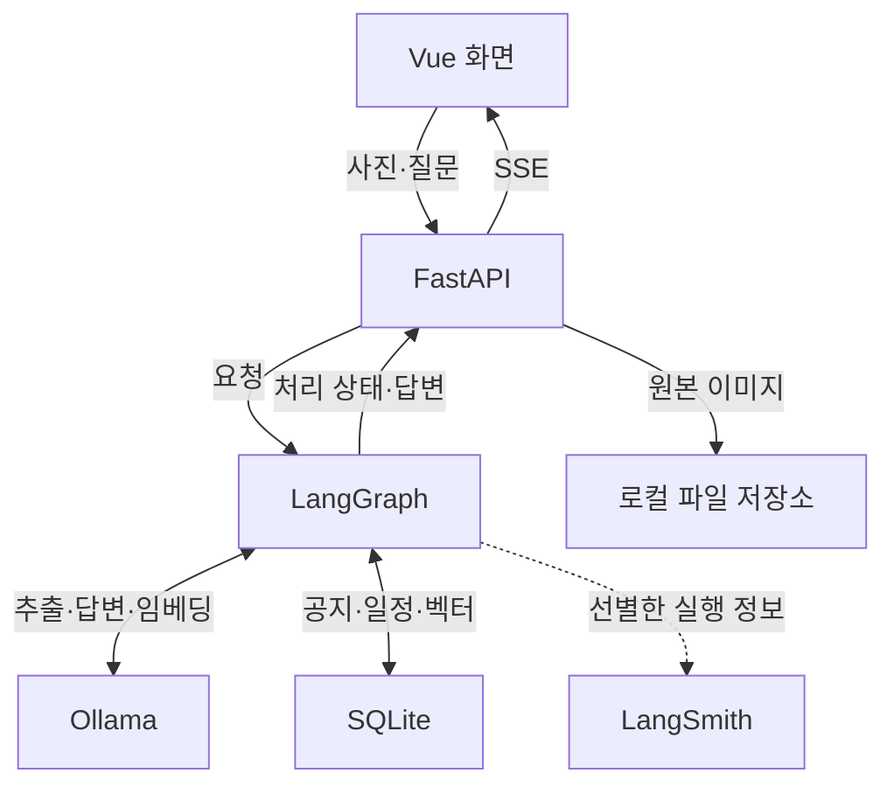

# Vision 기반 사내 공지·일정 관리 Agent 기획안

## 1. 주제 선정

### 1.1 주제명

**Vision 기반 사내 공지·일정 관리 Agent**

공지 사진에서 필요한 정보를 추출·저장하고, 자연어 질문으로 공지 내용과 일정을 확인하는 AI 서비스.

### 1.2 선정 배경

사진이나 캡처로 전달된 사내 공지는 사용자가 내용을 읽고 필요한 일정을 직접 옮겨 적어야 한다. 공지가 쌓이면 관련 내용을 다시 찾기 어렵고, 신청 마감일과 실제 행사일을 혼동하거나 제출 기한을 놓칠 수 있다. 이미지 속 정보를 검색 가능한 데이터로 전환해 이러한 불편을 줄이고자 한다.

### 1.3 개발 목적

- 공지 이미지에서 제목, 대상, 신청·제출 마감일, 행사 일시, 장소, 해야 할 일을 추출해 저장한다.
- 신청 마감과 행사 일정을 구분하고 날짜를 검증해 일정 관리의 정확성을 높인다.
- 기간 조건에 따른 일정 조회와 공지 내용 기반 질의응답으로 필요한 정보를 쉽게 확인하도록 돕는다.

### 1.4 예상 사용자

- **일반 임직원:** 자신에게 해당하는 교육·행사·서류 제출 공지와 기한을 확인하는 사용자.
- **인사·총무·교육 담당자:** 공지를 등록하고 관련 일정과 신청·제출 방법을 확인하는 사용자.

### 1.5 주요 활용 사례

| 활용 사례           | 사용자 요청 예시                      | 서비스 제공 내용                                                     |
| ------------------- | ------------------------------------- | -------------------------------------------------------------------- |
| 공지 이미지 등록    | “이 보안교육 공지를 등록해줘.” + 사진 | 공지 정보를 추출·검증해 저장하고 신청 마감과 교육 일정을 구분해 제시 |
| 기간 기반 일정 조회 | “이번 주에 마감되는 공지를 알려줘.”   | 저장된 일정에서 해당 기간의 마감 일정을 찾아 정리                    |
| 공지 내용 질의응답  | “보안교육은 어디에서 신청해야 해?”    | 관련 공지를 검색해 신청 방법과 근거 내용을 안내                      |

## 2. 요구사항 분석

### 2.1 해결하려는 문제

- 이미지 공지의 일정과 신청 방법을 직접 읽고 옮겨 적어야 하는 불편.
- 신청·제출 마감과 행사 일시의 혼동, 필요한 공지를 다시 찾기 어려운 문제.

### 2.2 기능 요구사항

| 기능        | 요구사항                                                                                                             |
| ----------- | -------------------------------------------------------------------------------------------------------------------- |
| 이미지 등록 | 공지 이미지 한 장을 업로드하고 첨부 여부를 확인한다.                                                                 |
| 정보 추출   | `qwen3-vl:4b`로 제목·대상·일정·장소·해야 할 일을 구조화 JSON으로 추출한다.                                           |
| 날짜 검증   | 신청·제출 마감과 행사 일정을 구분하고 날짜 형식·필수값을 검사한다.                                                   |
| 데이터 저장 | 검증된 공지·일정은 SQLite에 저장하고, 공지 임베딩을 검색에 연결한다. 미확정 정보는 `needs_review` 초안으로 관리한다. |
| 검색·답변   | 기간·상태 조건은 SQL, 내용·의미 검색은 RAG로 처리하고 근거와 함께 답변한다.                                          |

### 2.3 데이터 요구사항

- **공지:** ID, 제목, 본문, 대상, 원본 이미지 참조, 추출 근거, 검증 상태.
- **일정:** 공지 ID, 일정 유형, 시작·종료 시각, 장소, 해야 할 일. 공지 한 건에 여러 일정을 연결한다.
- **검색 데이터:** 공지별 임베딩과 공지 ID의 연결 정보. 샘플 공지에는 사람이 확인한 정답을 별도로 준비한다.
- 불명확한 값은 `null`로 보존하고, 확정할 수 없는 필수 일정은 확인 필요 상태로 표시한다.

### 2.4 Agent 동작 흐름

`route`에서 일반 대화·공지 등록·공지 조회로 분기한다.

- **일반 대화:** `chat_answer`에서 응답 후 종료.
- **공지 등록:** 이미지 확인 → Vision 추출 → 날짜 정규화·검증 → 임베딩 생성·공지 및 일정 저장 → 등록 결과 응답. 보완이 필요하면 최대 1회 재추출하고, 미해결 시 초안으로 저장한다.
- **공지 조회:** SQL 또는 RAG 선택 → 데이터 검색 → 결과 정리·근거 제시 → 응답 종료.

### 2.5 비기능 요구사항

- **신뢰성:** 원문 근거로 답변하고, 날짜는 `Asia/Seoul` 기준으로 해석한다. 원문에 없는 날짜는 임의로 확정하지 않는다.
- **안정성·지속성:** 재시도 상한과 동일 요청의 중복 저장 방지를 적용하고, 재시작 후에도 저장한 데이터를 유지한다.
- **사용성:** Vue 화면에서 이미지 업로드, 처리 상태, 추출 결과와 검색 답변을 확인할 수 있어야 한다.
- **관측성:** 처리 시간·재시도·오류를 LangSmith Trace로 확인하고, 외부 추적에는 원본 이미지와 공지 본문을 제외한다.

### 2.6 최소 프로토타입 범위

- 단일 사용자·로컬 실행을 기준으로 공지 등록, 기간 조회, 내용 질의응답을 구현한다.
- 샘플 공지 이미지 10장과 검색 질문 10개로 핵심 동작을 확인한다.
- 이미지 누락, 날짜 불명확, 검색 결과 없음에 대한 안내를 제공한다.

### 2.7 예상 결과

- 사진으로 등록한 사내 공지와 일정을 자연어로 조회할 수 있는 웹 프로토타입.
- 주요 필드 추출 정확도, 일정 유형 구분 정확도, 검색 정답률, 응답 시간의 측정 결과.
- 동일한 입력으로 검증 적용 전후를 비교한 Before/After 수치와 확인된 한계.

## 3. 시스템 설계

### 3.1 전체 시스템 구성

LangGraph는 등록·조회·일반 대화 경로를 제어한다. 공통 State에는 요청 유형, 이미지 ID, 추출·검색 결과, 검증 상태, 재시도 횟수를 보관한다. 날짜 검증과 저장·조회는 별도 함수로 분리한다.

### 3.2 기술 스택 및 선정 이유

| 영역      | 기술 선정안                         | 역할·선정 이유                                                    |
| --------- | ----------------------------------- | ----------------------------------------------------------------- |
| 화면      | Vue 3                               | 기존 화면을 활용해 이미지 업로드와 채팅·처리 상태 표시            |
| API       | FastAPI·SSE                         | 업로드 API와 Agent 호출을 연결하고 진행 상태·답변 전달            |
| Agent     | LangGraph                           | 요청 분기, 검증, 제한된 재시도 흐름 구성                          |
| 로컬 모델 | Ollama·`qwen3-vl:4b`·`qwen3:8b`     | Vision 모델은 이미지 추출, 텍스트 모델은 요청 분류·답변 생성 담당 |
| 추출 검증 | JSON Schema·Pydantic·날짜 처리 코드 | 출력 구조·타입과 날짜 규칙을 검사하고 원문 근거와 대조            |
| 저장      | SQLite·로컬 이미지 파일             | 단일 사용자 프로토타입의 공지·일정·원본 관리                      |
| 검색      | `bge-m3` 임베딩·NumPy               | 공지와 질문을 벡터화하고 코사인 유사도로 관련 공지 검색           |
| 추적      | LangSmith                           | 이미지·공지 본문을 필터링하고 단계별 시간·오류·재시도 기록        |

샘플 10장 규모에서는 공지별 벡터를 SQLite에 저장해 읽어온 뒤 유사도를 계산한다. 검색한 공지 본문을 텍스트 모델에 전달해 근거 기반 답변을 생성한다.

기술 참고: [Vision 모델](https://ollama.com/library/qwen3-vl:4b), [텍스트 모델](https://ollama.com/library/qwen3:8b), [구조화 출력](https://docs.ollama.com/capabilities/structured-outputs), [임베딩 모델](https://ollama.com/library/bge-m3).

### 3.3 데이터 저장 구조

| 저장 대상           | 주요 항목·관계                                                      |
| ------------------- | ------------------------------------------------------------------- |
| `notices`           | 공지 ID, 제목, 본문, 대상, 이미지 경로, 상태, 중복 방지용 요청 ID   |
| `notice_events`     | 일정 ID, 공지 ID, 유형, 시작·종료 일시, 장소, 해야 할 일, 근거 문장 |
| `notice_embeddings` | 공지 ID, 임베딩 모델명, 벡터 JSON                                   |

- 공지와 일정은 **1:N**, 공지와 현재 사용 모델의 임베딩은 **1:1**로 연결한다. 원본 이미지는 로컬 파일로 저장하고 DB에는 경로를 기록한다.
- 상태는 `validated`와 `needs_review`로 구분한다. 기본 일정 조회·RAG 검색에는 검증된 공지를 사용하고, 초안은 등록 결과에서 확인 필요로 표시한다.
- 등록 요청 ID에 고유 제약을 적용해 같은 요청의 재실행으로 생기는 중복 저장을 방지한다.

### 3.4 주요 API

| 메서드·경로                    | 입력                                       | 처리·출력                                                                   |
| ------------------------------ | ------------------------------------------ | --------------------------------------------------------------------------- |
| `POST /api/images`             | 공지 이미지 파일                           | 로컬 저장 후 `image_id` 반환                                                |
| `POST /api/chat`               | `message`, 선택적 `image_id`, `request_id` | LangGraph로 등록·조회·일반 대화를 처리하고 상태·답변·등록 결과를 SSE로 반환 |
| `GET /api/notices`             | 기간, 일정 유형, 상태 등의 조건            | 서버가 정한 조건 쿼리로 공지·일정 목록 반환                                 |
| `GET /api/notices/{notice_id}` | 공지 ID                                    | 공지 본문, 연결 일정, 검증 상태, 원본 이미지 참조 반환                      |

프론트엔드는 이미지 업로드 후 받은 ID를 채팅 요청에 첨부한다. 등록 결과에는 저장된 공지 ID와 상태를 포함하고, 조회 답변에는 근거 공지 ID를 함께 전달한다.

## 4. 개발 일정

### 4.1 1일 차: 데이터 구조와 이미지 추출

- SQLite 공지·일정·임베딩 스키마를 정의하고 이미지 업로드 API를 구현한다.
- `qwen3-vl:4b`를 연결해 공지 이미지에서 구조화 JSON을 추출한다.
- 샘플 공지 10장과 필드별 정답을 준비하고 초기 추출 정확도와 오류 유형을 기록한다.

**완료 기준:** 이미지 업로드부터 JSON 추출까지 API로 실행할 수 있고, 샘플 10장의 추출 결과와 정답 대조표가 준비되어 있다.

### 4.2 2일 차: Agent 등록과 검색

- LangGraph 등록 경로에 날짜 정규화·필수값 검증·최대 1회 재추출을 연결한다.
- 검증된 공지·일정 저장과 `needs_review` 초안 처리를 구현하고 중복 저장을 방지한다.
- 임베딩 생성과 RAG 검색을 연결하고, 기간·상태 조건에 따른 SQL 검색을 구현한다.

**완료 기준:** 백엔드에서 공지 등록·기간 조회·내용 질의응답을 실행할 수 있다. 불명확한 날짜는 초안으로 처리되고, 동일 요청을 다시 실행해도 중복 저장되지 않는다.

### 4.3 3일 차: 화면 연결·검증·발표 준비

- Vue에 이미지 업로드, 등록 결과, 처리 상태와 검색 답변 화면을 연결한다.
- 날짜 검증·기간 검색·중복 저장 등 핵심 로직의 단위 테스트를 수행한다.
- 공지 이미지 10장과 검색 질문 10개를 평가하고, 동일 입력·모델 조건에서 검증 적용 전후의 정확도·응답 시간을 비교한다.
- LangSmith Trace에서 실행 시간·재시도·오류 기록을 확인한다.
- 결과보고서·발표 자료를 작성하고 등록 → 기간 조회 → 내용 질의응답 순서로 시연을 준비한다.

**완료 기준:** 세 가지 핵심 기능을 웹 화면에서 시연할 수 있고, 테스트 결과·Before/After 수치·Trace 기록·결과보고서·발표 자료가 준비되어 있다.

**제출 일정:** 3일 차 14시까지 구현·평가를 마치고 Git 주소와 결과보고서 주소를 등록한다. 이후 발표 자료와 시연을 최종 점검하고 17시 30분까지 발표를 진행한다.
